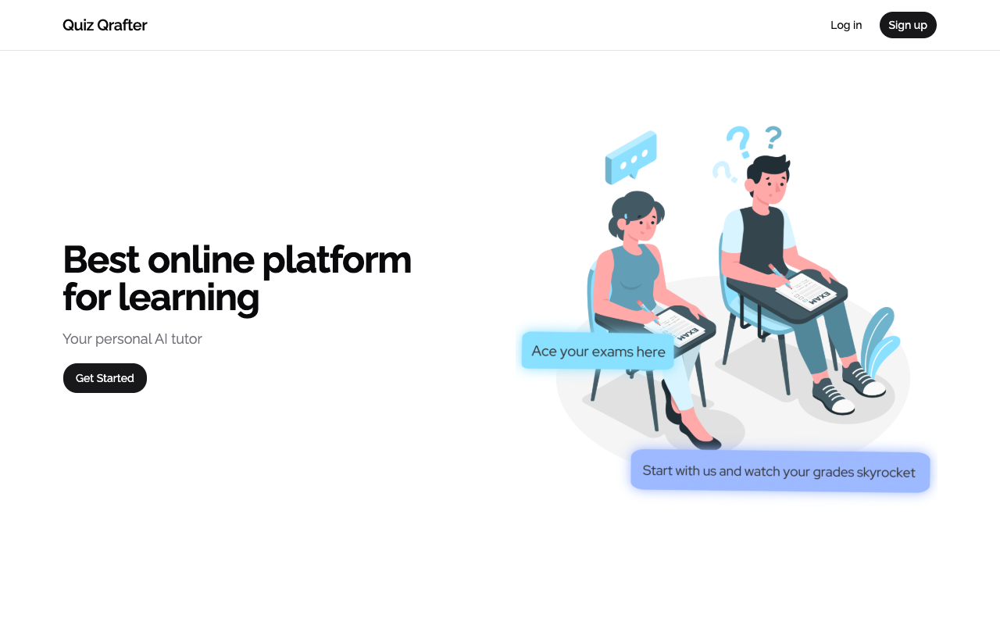
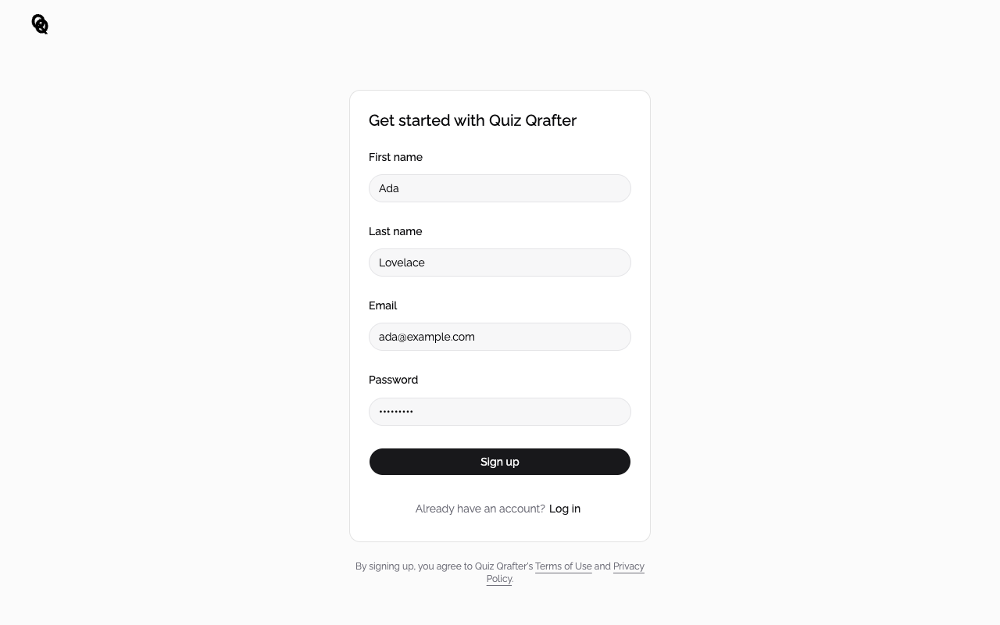
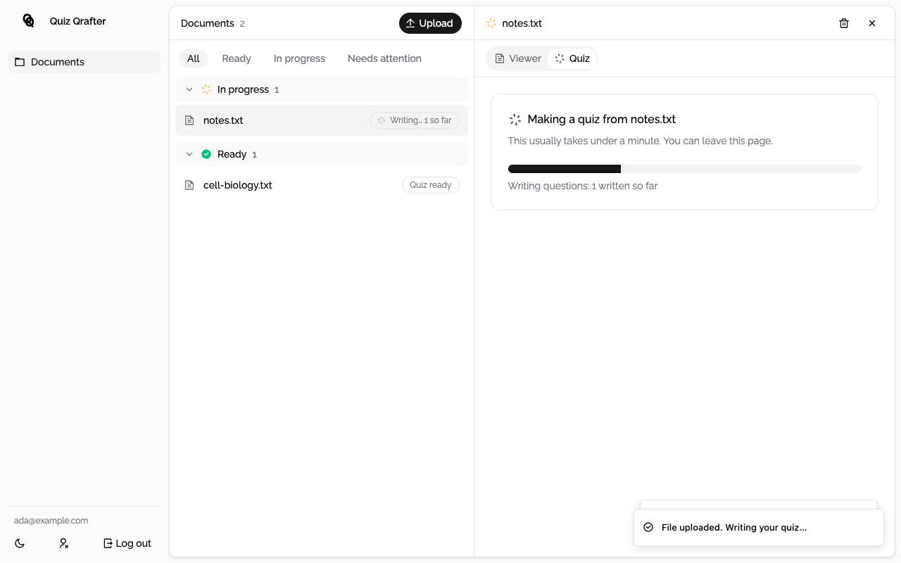
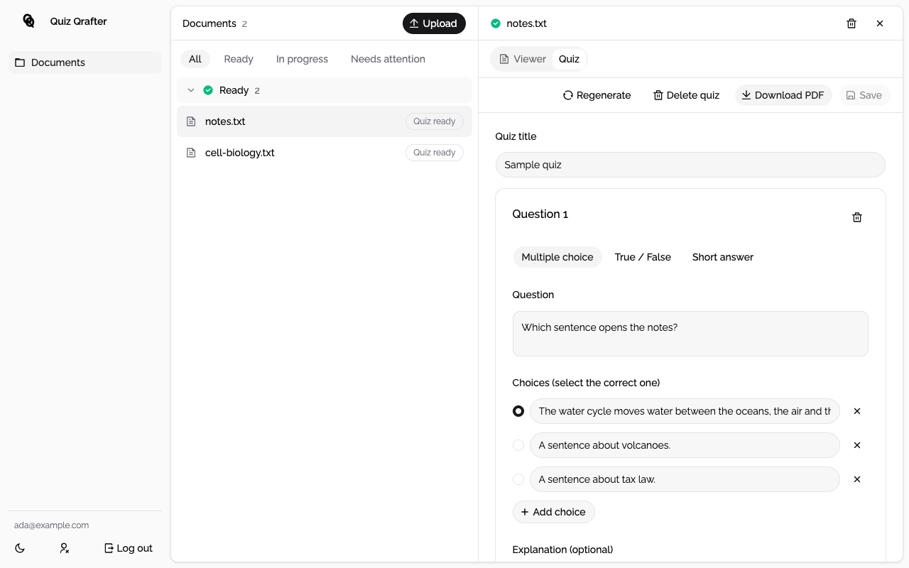

# Quiz Qrafter

Upload your study notes (PDF, image, Word or text), and AI writes a quiz from them that you can edit and download.

### Screenshots

|                                                                                    |                                                                                     |
| ---------------------------------------------------------------------------------- | ----------------------------------------------------------------------------------- |
|                                           |                                                |
| **Home**                                                                           | **Sign up**                                                                         |
|  |  |
| **A quiz being written**                                                           | **Dashboard, with a finished quiz open**                                            |

The screenshots are taken by a Playwright script against the e2e servers, using the fake AI. After changing the UI, run `npm run screenshots` to retake them.

### Requirement(s)

- [Node.js](https://nodejs.org/) with `npm`
- [Docker](https://www.docker.com/)

### Development Setup

```bash
# Initialize environment variable file
cp frontend/.env.example frontend/.env
cp backend/.env.example backend/.env

# Start Postgres, and Grafana LGTM for traces and logs (Grafana on http://localhost:3001)
docker compose up -d

# Start application(s)
npm install
npm run dev

# ClEAN UP
# docker compose down
```

### Checks

This project uses [Vite+](https://viteplus.dev/) (`vp`) for task running, formatting, linting, and type checking.

```bash
npx vp check        # format, lint, and type check
npx vp check --fix  # apply formatting and lint fixes
npm run build       # build every workspace package (vp run -r build)
```

Installing the global [`vp` CLI](https://viteplus.dev/guide/) lets you drop the `npx` prefix.
